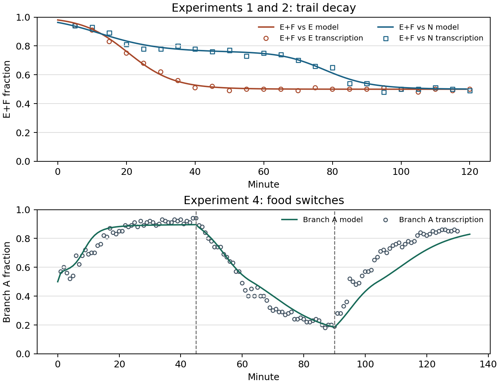

# Reproduced curves

The upper panel compares predicted E+F fractions with observations
transcribed from the trail-decay experiments. The E+F versus E curves
approach even allocation sooner than the E+F versus N curves. The
lower panel shows the modeled branch-A preference changing direction
after each food switch. Points show the transcribed dynamic observations
at their recorded minutes. The module imputes the minute-zero point
from the first plotted value, so the panel omits that duplicate
[@ant-source; @dussutour2009].

{#fig:foraging_curves width=88% fig-alt="Two panels show E+F preference declining in the decay experiments and branch-A preference falling then rising following the food switches."}
